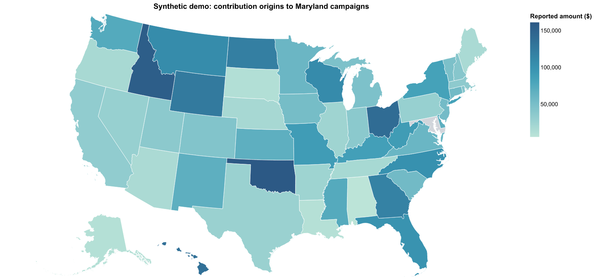
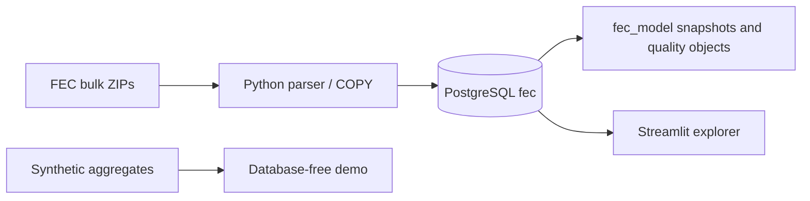
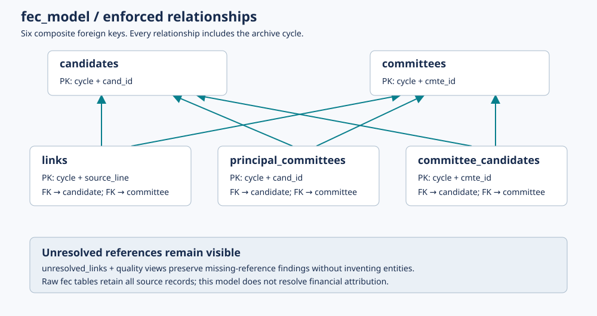

# Campaign Finance Explorer

Explore where reported contributions to congressional campaign committees originate,
backed by a Python ingestion pipeline and a PostgreSQL relationship model.
Maryland is the starting point; the live contribution map supports every state plus DC.

[](https://github.com/ianhoff/FEC-Data-Exploration/actions/workflows/tests.yml)



*Rendered preview from the shared map component, using synthetic demo values.
It is not a screenshot of live FEC findings.*

## Try the demo in minutes

No PostgreSQL, account credentials, or FEC download is needed. Requires Git and Python 3.10+.

```powershell
git clone https://github.com/ianhoff/FEC-Data-Exploration.git
cd FEC-Data-Exploration
py -m venv .venv
.\.venv\Scripts\python.exe -m pip install -r requirements-app.txt
.\.venv\Scripts\python.exe -m streamlit run demo_app.py
```

Open http://127.0.0.1:8501. Reuse an existing virtual environment rather than
recreating it. On macOS/Linux use `python3 -m venv .venv` and `.venv/bin/python`
for subsequent commands. Stop another app using port 8501 first, or pass
`--server.port 8502` to the demo command.

The demo includes Maryland, Delaware, and California campaign selections,
amount/count measures, state exclusion, CSV exports, and a model tour.
**Every financial value is invented and prominently labeled synthetic.**
The live app adds all-state selection, candidate/election-year/date filters,
national raw-table exploration, candidate profiles, and data-quality checks.

The requirements install the `src/fec_explorer` package in editable mode. If you
already have dependencies installed after updating this checkout, run
`.\.venv\Scripts\python.exe -m pip install -e .` once to register the package.
The root `app.py`, `demo_app.py`, and CLI wrappers keep their existing commands.
See [source layout](docs/source-layout.md) for package structure and resource paths.

## Engineering focus

- Stream ZIP records into PostgreSQL COPY with bounded Python memory.
- Replace each dataset/cycle atomically; preserve prior data on parsing/COPY failure.
- Keep raw text and source lineage; investigate missing references rather than discarding them.
- Build a separate snapshot model with six validated composite foreign keys.
- Aggregate contribution origins by distinct principal recipient committee IDs.
- Test ingestion rollback, relational integrity, numeric/date edge cases, and actual SVG rendering.

The local project imported **58,210,165 reported contribution records** for the
2024 cycle. That is an observed source snapshot, not a benchmark or unique-donor
count. The public repository includes synthetic fixtures, not downloaded archives
or contributor-level extracts.

## Architecture and model





Raw tables preserve unresolved references. Validated relationship tables enforce
keys; separate quality objects retain exceptions. The live UI queries raw data,
so relationship validation never silently changes raw counts.

## Run with real FEC data

Follow [local setup and operations](docs/operations.md). Copy the example configs
locally, import the small datasets, and provision analysis access once. PostgreSQL
16+ is required for the contribution map. Nationwide contributions are a separate,
large import requiring download and database/WAL storage planning.

```powershell
Copy-Item config.example.json config.json
# After PostgreSQL setup, the small import, and analysis-account provisioning:
.\.venv\Scripts\python.exe -m streamlit run app.py
```

Keep local configs and credentials out of Git. The demo does not require either
config file. Existing users should keep their working configs rather than overwrite them.

## Tests and CI

```powershell
.\.venv\Scripts\python.exe -m pip install -r requirements-dev.txt
.\.venv\Scripts\python.exe -m pytest -m "not integration"
```

The full suite uses synthetic records in an explicitly configured, empty disposable
`fec_test_*` PostgreSQL database. [Testing instructions](docs/testing.md) explain
`FEC_TEST_DSN`, safeguards, and `--require-db`. GitHub Actions runs Python 3.11/3.14
with PostgreSQL 16/18 and uploads coverage/JUnit reports. See the badge for actual
hosted results; local execution does not establish that every CI job passed.

## Data interpretation and limitations

Contributions are source transaction records, not unique donors. The individual
bulk file is not every donation. Memo entries, amendments, negative amounts, and
all source transaction types are retained; amendments are not reconciled.
Displayed sums are **exploratory recorded amounts, not official fundraising totals**.
See [the calculation policy](docs/data-model.md#contribution-origins-analysis-policy).

Archive cycle, candidate election year, and transaction date are distinct filters.
The campaign-state selector uses the state of the race, not contributor residence.
The selected campaign state is excluded from map colors by default to expose
variation elsewhere; its totals remain available.

Current limits: local-only app without login; explicit model rebuilds after raw
refreshes; no immutable source-version history; source attributes largely remain
text; no persisted contribution model. The demo illustrates UI behavior rather
than pipeline performance. Public hosting is separate work.

## Documentation

- [Architecture](docs/architecture.md), [data model](docs/data-model.md), and [field dictionary](docs/data-dictionary.json)
- [Design decisions](docs/decisions/0001-raw-ingestion-and-local-explorer.md) and [enforced relationships](docs/decisions/0002-enforced-relationship-snapshots.md)
- [Operations](docs/operations.md), [testing](docs/testing.md), and [publication audit](docs/publication.md)
- [Agent/developer guide](AGENTS.md)

## License and attribution

Original code and synthetic demo values use the [MIT license](LICENSE).
FEC source data and bundled map assets have separate provenance and applicable
rules; see [third-party notices](THIRD_PARTY_NOTICES.md). No third-party endorsement
is implied.
