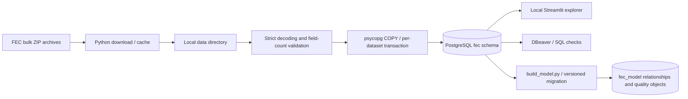

# Architecture and operations

## Current system

The portfolio entry point is Campaign Finance Explorer. The live app retains its
Maryland overview/race pages and an all-state contribution map. `demo_app.py`
provides a separate database-free presentation using invented aggregate values,
sharing map rendering functions with the live application. It does not demonstrate
live ingestion or query performance. See [publication preparation](publication.md).

PostgreSQL runs locally on port 5432; the database is `fec_project`. Streamlit
binds to `127.0.0.1:8501`. DBeaver and Python independently connect to the same
database. DBeaver is not an ingestion component.

## Code map

| File | Responsibility |
| --- | --- |
| `src/fec_explorer/ingestion.py` | Dataset definitions, cached downloads, parsing, COPY and import tracking |
| `src/fec_explorer/modeling.py` | Migration application and atomic model refresh |
| `src/fec_explorer/database.py` | Live read-only query helper |
| `src/fec_explorer/application.py` | Live navigation and error handling |
| `src/fec_explorer/pages/` | Individual live page implementations |
| `src/fec_explorer/origins.py` | Contribution aggregation and choropleth rendering |
| `app.py`, `ingest_fec.py`, `build_model.py` | Thin root entrypoints retaining existing commands |
| `check_origins.py` | Synthetic SQL edge cases and live contribution-map interaction checks |
| `check_map_render.py` | Offline SVG map rendering checks, including Maryland exclusion |
| `src/fec_explorer/access.py` | One-time role/schema provisioning; root setup_db_access.py is its wrapper |
| `check_app.py` | Live database Streamlit AppTest smoke checks for the original 2024 snapshot |
| `verify_import.sql` | Connection identity, actual/tracked counts, duplicate IDs, unresolved links |
| `explore.sql` | Starter queries; contribution queries require a separate contribution import |
| `src/fec_explorer/schema_export.py` | Read-only catalog export; root export_schema.py is its wrapper |
| `check_model.py` | Live model reconciliation and rollback-only foreign-key rejection checks |
| `verify_model.sql` | DBeaver queries for model counts, foreign keys, and unresolved references |
| `.streamlit/config.toml` | Loopback server, theme, telemetry preference |

`pyproject.toml` discovers the installable package under `src/`. `requirements.txt`
installs it in editable mode with ingestion dependencies; `requirements-app.txt`
adds Streamlit, pandas, and Altair explicitly. Dependency ranges are not a lockfile.
See [source layout](source-layout.md) for package, entrypoint, and resource boundaries.

## Ingestion lifecycle

1. Parse CLI options. Default cycle is 2024; default datasets are candidates,
   committees, and links. An even year from 1980 through 2098 is accepted, but this
   does not guarantee file availability or layout compatibility.
2. Read non-secret connection settings, prompt for the importer password unless
   `PGPASSWORD` is supplied, and connect with autocommit outside explicit transactions.
3. Reuse a cached ZIP unless `--refresh` is specified. Downloads use a `.zip.part`
   temporary file, validate ZIP format, then replace the cache entry. The cache
   holds one version per dataset/cycle; refresh does not retain previous versions.
4. Match exactly one expected ZIP member. Stream strict `utf-8-sig`, split each
   nonblank physical line on `|`, require the expected number of fields, and map
   empty fields to NULL. Other whitespace is retained.
5. For each dataset, acquire transaction advisory lock `(721039, 1)`, create raw
   objects if absent, delete the selected cycle, COPY records, create indexes,
   and upsert `fec.imports`. Reject an empty parsed source. Commit together.
6. Run ANALYZE after that dataset commits. An ANALYZE failure can therefore be
   reported after data is already committed; do not interpret every failure as
   proof that the current dataset rolled back.

A parsing/COPY failure rolls back the active dataset's transaction. Earlier
datasets remain committed. A failed refresh may leave a newly downloaded cache
archive alongside the previous database contents. Imports do not resume mid-file.
The advisory lock serializes this script's load transactions; it does not
serialize downloads or arbitrary external writers.

## Application lifecycle

`query()` reads `config.analysis.json`, opens a short connection using libpq
authentication, and enables read-only transactions with a 15-second statement
timeout for ordinary screens. No connection pool is used. The contribution origins
aggregate has a 180-second timeout and five-minute in-memory cache; cache keys
include cycle, distinct committee IDs, dates, and source import metadata. Refresh
clears that aggregate cache. Other screens rerun live queries on interaction.
Browser reload/Rerun does not guarantee that an edited imported module is reloaded.
For stale function signatures or behavior, stop Streamlit with Ctrl+C, restart it,
then reload the browser. This does not require reimporting source data.

Archive choices come from `fec.imports`, so a partially imported cycle can appear
before all three small datasets have been loaded. The UI is not a guarantee of
cross-dataset snapshot consistency.

Maryland pages filter candidate race state to MD and office to H/S. Election year
defaults to the archive year when present. Candidate profiles join committees
within the same cycle and show all linkage election years for the selected ID.
The left join preserves links whose committee is missing. House districts and
Senate selection affect the directory; overview metrics describe the selected
election-year population before those race filters.

National tables use 100-row pages and bound search/filter values. CSV export is
the displayed page, not all matching records. The quality page exports all
unmatched links for the selected archive. Contribution origins queries raw
contributions only for the selected campaign state's principal committee IDs
(50 states plus DC, default Maryland). Candidate race state is a bound query
parameter; the other Maryland pages retain their original scope. It uses
PostgreSQL 16+ `pg_input_is_valid` to validate ISO dates reconstructed from source
MMDDYYYY text. SQL computes exact numeric sums; chart values convert to floats for
display. Only state-level aggregates, not contributor rows, reach the browser.

The map uses packaged `fec_explorer/resources/us-states-10m.json` TopoJSON from us-atlas, with integer
FIPS lookup IDs and Albers USA projection. It requires no map service at runtime.
The inline data format explicitly declares `type='topojson'`; a feature name alone
does not tell Vega to decode topology. `check_map_render.py` renders SVG offline
to check all 51 state/DC shapes, numeric legends, and color variation. The selected
campaign state defaults to gray and is excluded from the color domain and map-share denominator;
the toggle can restore it. Overall totals and exports retain it. Install
`requirements-dev.txt` for the optional `vl-convert-python` rendering dependency.
See [the analysis policy](data-model.md#contribution-origins-analysis-policy) for
inclusion rules, unknown locations, and attribution limits. Missing-cycle and
empty-selection states are handled without starting an import.

## Authentication boundaries

The importer normally uses `postgres`. The app uses `fec_project_user`, which
can SELECT raw tables and owns `fec_model`. App read-only behavior is imposed by
its connections, not by a fully read-only role. Default SELECT privileges apply
to future `fec` tables created by `postgres`, not tables created by every role.

Passwords stay outside the checkout in the Windows PostgreSQL password file;
non-secret JSON configs can be inspected normally. Provisioning is interactive.
Do not rerun setup automatically or read password files for debugging.

## Validation and maintenance

The portable pytest suite in `tests/` runs unit and SVG-rendering tests without a
database and integration tests against explicit disposable `fec_test_*` targets.
GitHub Actions runs the full suite using PostgreSQL services. See
[testing guide](testing.md) for setup, report commands, and cleanup safeguards.
These tests are separate from the root local snapshot checks described below.
`fec_explorer.modeling.build()` and `fec_explorer.origins.fetch_aggregate()` accept explicit connections;
their CLI/UI wrappers retain the existing authentication and transaction behavior.
Candidate-recipient selection and principal-ID deduplication are shared with app
code so synthetic tests cover the same selection rules used by the map.

Run syntax/dependency checks for code changes, `check_app.py` for UI/query changes
against the initial snapshot, and `verify_import.sql` after imports. For new cycles,
validate source layouts and evaluate quality rather than assuming the original
2024 counts apply. AppTest checks behavior without visual browser inspection.

Use `export_schema.py` to regenerate `docs/schema.snapshot.json`. The exporter
contains catalog metadata only and records when it was generated. The schema
snapshot documents actual database objects; the dictionary documents source
intent, including optional tables which may not exist yet.

## Planned, not implemented

Source-file checksums, immutable source snapshots, detailed pipeline-run history, scheduling,
fully typed model conversions and official fundraising-total
reconciliation are future work. The first versioned relationship-model migration
is implemented; see [data model](data-model.md#enforced-relationship-model).

## Model build operations

Run `.\.venv\Scripts\python.exe build_model.py` to migrate and build all imported
small-dataset cycles; use `--cycle 2024` to limit refreshes. The account uses
`config.analysis.json`. One transaction covers the migration and all selected
cycles, with children deleted before masters during replacement. Raw rows and
contribution records are never modified. The build takes the importer's advisory
lock and records source import metadata, while unresolved links are materialized
alongside validated links. It does not guarantee consistency with arbitrary
writers that ignore the advisory lock.

Run `check_model.py` to reconcile masters and the link partition and confirm all
six foreign keys are validated. Invalid-reference probes run in savepoints and
the entire check transaction rolls back. Regenerate the schema snapshot after
migrations. The UI continues to query raw tables, so a model rebuild does not
change its displayed record counts.
