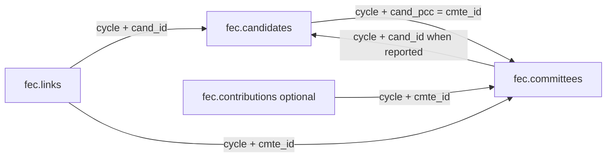
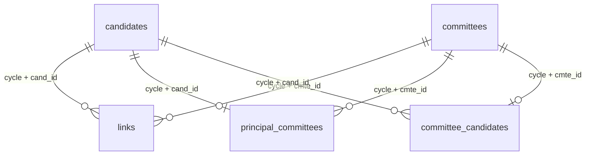

# Data model

## Schemas and grain

`fec` is the raw ingestion layer. Every source field is nullable PostgreSQL text.
The importer adds `cycle integer NOT NULL` and `source_line bigint NOT NULL`.
All four source tables have the enforced primary key `(cycle, source_line)`.
Empty strings become NULL; other values remain as decoded source text.

| Table | Grain | Business identifiers | Availability |
| --- | --- | --- | --- |
| `fec.candidates` | A candidate master source record in an archive | `cand_id` | Default import |
| `fec.committees` | A committee master source record in an archive | `cmte_id` | Default import |
| `fec.links` | A reported candidate–committee linkage record | `linkage_id`, candidate and committee IDs | Default import |
| `fec.contributions` | A disclosed transaction source record, not a person | `sub_id`, report-scoped `tran_id` | Explicit optional import |
| `fec.imports` | Latest successful load of one dataset/cycle | `(dataset, cycle)` | Created on first load |

Candidate and committee IDs were unique/non-null in the checked initial 2024
snapshot. `(cycle, cand_id)` and `(cycle, cmte_id)` are candidate modeled keys,
not enforced raw unique constraints. Profile each new snapshot before adopting them.
`source_line` is a physical line number; skipped blank lines can leave gaps.
It is not stable across refreshed source files.

## Logical relationships

The diagram describes intended navigation. Only the raw primary keys are enforced;
there are no raw foreign keys, and references can be missing.

Candidate IDs persist across cycles for the same office. A change of office can
have a different ID. Committee IDs identify committees across cycles. Neither
observation removes the need for cycle-aware joins between archived attributes.
The linkage table allows multiple relationships and election years per candidate.
Do not assume one candidate has exactly one linkage record or that every link is
a principal campaign committee.

## Time semantics

- `cycle`: archive selected by the importer; an even-year label for a two-year period.
- `cand_election_yr`: source-reported candidate election year; raw text and not
  necessarily equal to archive cycle. Unusual values remain untouched.
- `fec_election_yr`: source-reported active two-year linkage period.
- `transaction_dt`: reported transaction date, raw MMDDYYYY text.
- `imported_at`: database tracking timestamp, not a source publication timestamp
  or independently recorded download timestamp. Its default is transaction `now()`.

The same cycle can be refreshed long after its calendar period. Current tracking
does not preserve historical file versions or their checksums.

## Tracking table

`fec.imports` has enforced primary key `(dataset text, cycle integer)`, plus
`source_url text`, `row_count bigint`, and `imported_at timestamptz DEFAULT now()`;
all are NOT NULL. A successful replacement updates that one metadata row in the
same transaction as the loaded data. Failed attempts are not recorded here.

## Indexes

In addition to raw primary keys, the importer creates nonunique indexes on:

- candidates: `(cycle, cand_id)`
- committees: `(cycle, cmte_id)`
- links: `(cycle, cand_id)` and `(cycle, cmte_id)`
- contributions, when imported: `(cycle, cmte_id)` and `(cycle, state)`

## Known initial-snapshot findings

The original checked 2024 load contained 9,796 candidates, 20,937 committees, and
8,619 links. Of the links, 154 lacked a matching candidate and 160 lacked a matching
committee: 130 lacked both, 24 only the candidate, and 30 only the committee.
Thus 184 link records had at least one unresolved reference. These are snapshot
observations, not permanent invariants or asserted causes. They also occur in the
cached source files. Recompute after refreshes; do not delete them to satisfy a key.

## Analysis rules

Maryland campaigns are selected using candidate `cand_office_st='MD'` and
`cand_office IN ('H','S')`, not mailing-address state. Maryland contributors would
instead be selected using contribution `state='MD'`. A candidate record does not
establish ballot qualification, election results, or current campaign activity.

Contributions connect to recipient committees, not directly to candidates. There
is no stable individual-donor ID. TRAN_ID is unique only within its reporting
context, not across committees/reports. Preserve SUB_ID and all amendment/memo
information; do not silently deduplicate records or sum every linked committee's
money as candidate fundraising. The individual file is a subset of disclosed
itemized contributions, not every donation. Raw sums are not official totals.

## Enforced relationship model

Migration `migrations/001_relationship_model.sql` creates a snapshot model:

| Object | Grain and constraints |
| --- | --- |
| `fec_model.candidates` | All raw candidate records; PK `(cycle,cand_id)`, UNIQUE `(cycle,source_line)` |
| `fec_model.committees` | All raw committee records; PK `(cycle,cmte_id)`, UNIQUE `(cycle,source_line)` |
| `fec_model.links` | Only links with both masters present; PK `(cycle,source_line)` and two NOT NULL composite foreign keys |
| `fec_model.unresolved_links` | Every remaining source link, retaining all fields plus `candidate_absent` and `committee_absent` flags |
| `fec_model.principal_committees` | Validated candidate `cand_pcc` relationships; PK `(cycle,cand_id)` and two foreign keys |
| `fec_model.committee_candidates` | Validated committee-master `cand_id` relationships; PK `(cycle,cmte_id)` and two foreign keys |
| `fec_model.unresolved_principal_committees` | View of nonnull candidate `cand_pcc` values absent from the modeled committee master |
| `fec_model.unresolved_committee_candidates` | View of nonnull committee `cand_id` values absent from the modeled candidate master |
| `fec_model.builds` | Latest model build per cycle, counts and captured `fec.imports` metadata |
| `fec_model.schema_migrations` | Applied migration filename, SHA-256 of migration SQL, and application timestamp |

All six foreign keys are enforced and validated; deletion uses PostgreSQL's
default NO ACTION behavior. There are no raw-to-model foreign keys. Source
references remain unchanged on modeled masters; navigate the separate relationship
tables when enforced relationships are required. Null source references mean no
reported relationship and do not populate unresolved-reference views.

Run `build_model.py` after raw imports; it defaults to all imported small-dataset
cycles, or accepts `--cycle 2024` (multiple years allowed). It rejects incomplete
imports, count mismatches, and missing/duplicate master identifiers. It does not
pick a duplicate winner. Migration and selected-cycle refreshes commit atomically.
It shares the importer's advisory lock, protecting against concurrent writes by
these scripts; arbitrary external writers are outside this coordination protocol.

The model is a snapshot, not live views over raw masters. After a raw refresh,
rebuild it deliberately. `builds.source_imports` identifies the metadata used;
it is latest-build provenance, not immutable history or a source-file checksum.
Applied SQL migrations are checksum-checked; add a new file for later changes.

The initial model builds contain 7,576 resolved + 107 unresolved links in 2022 and
8,435 resolved + 184 unresolved links in 2024. Every raw link is represented once.
The app still reads raw `fec` tables. Refresh `fec_model` in DBeaver to see actual
relationship lines in its ER diagram. Contributions remain only in the raw layer;
this migration does not copy or enforce relationships on that large table.

## Further typing work

`fec_model` is owned by `fec_project_user`. The current relationship model retains
source columns as text; relationship validation does not imply full value validation.
A future migration should:

1. Profile uniqueness and references for each cycle.
2. Convert validated years, dates, and exact decimal amounts while retaining
   lineage to `(cycle, source_line)` and reporting rejected conversions.
3. Explicitly handle unresolved relationships before adding foreign keys.
4. Define amendment/memo/attribution policy for each financial analysis.

Source definitions and limitations are linked per table in the dictionary.

## Contribution origins analysis policy

The Contribution origins page is an exploratory analysis over raw contributions,
not a new persisted model or an official fundraising calculation.

- Recipients are distinct nonnull `cand_pcc` values from House/Senate candidate
  records in the selected campaign state and archive (all 50 states plus DC,
  default Maryland). Race state is selected with `cand_office_st`; it is not a
  filter on the contributor's location. Recipients are optionally restricted by candidate
  election year and candidate ID. The election year defaults to the archive year.
  All candidates remain eligible regardless of reported candidate status; this
  does not establish ballot participation. Missing principal IDs are counted.
- The recipient criterion is the candidate's reported principal committee ID,
  without expanding to other candidate–committee links. Committee IDs are deduplicated
  before filtering contributions, preventing multiplication of transaction records.
- Contribution selection includes `cycle` and recipient `cmte_id`. It is not a
  sum across every committee associated with a candidate, and it does not require
  a principal ID to also occur in the committee master.
- All transaction/entity types, amendments, and memo records are retained. No
  amendment resolution, deduplication, unique-donor calculation, or financial
  attribution adjustment is applied. Record counts count source rows.
- A separate reported transaction-date range defaults to January 1 of cycle-1
  through December 31 of cycle. Invalid/missing dates and out-of-range records
  are counted in inclusion checks and excluded from the map. PostgreSQL validates
  the reconstructed ISO date; impossible dates are not normalized silently.
- Amount sums accept signed decimal text matching the documented regex (under
  1,000 characters) and use PostgreSQL numeric. Invalid/missing amounts count as
  records but do not contribute to amount sums. Negative amounts remain signed.
  Numeric zero is displayed for no parseable amounts; invalid-amount counts remain
  visible in the table and inclusion checks.
- Exact source state codes matching the 50 states or DC appear on the map.
  Null, territory, foreign, whitespace, lower-case, and other codes remain in the
  separate unmapped table; the page does not silently normalize them.
- Map measures are reported amount sum or source record count. Tooltip shares
  use states/DC included in the color scale, with signed amount denominators; a zero denominator
  has no defined share. Negative values use a diverging color scale. Empty states
  have zero values. Totals above the map include unmapped included locations.
- By default the selected campaign state is gray and excluded from the map color domain and tooltip
  share denominator, with its totals shown separately. A toggle restores it.
  Hover tooltips explicitly label whether a state is included in or excluded
  from the color scale and map shares; excluded states still show their totals.
  Overall metrics, state tables, and CSV exports continue to include that state.

`origins_validation.json`, when present, is a generated aggregate verification
artifact, not a stable data source. Refresh after source changes. The map does not
depend on it, and no schema migration was required for this feature.
